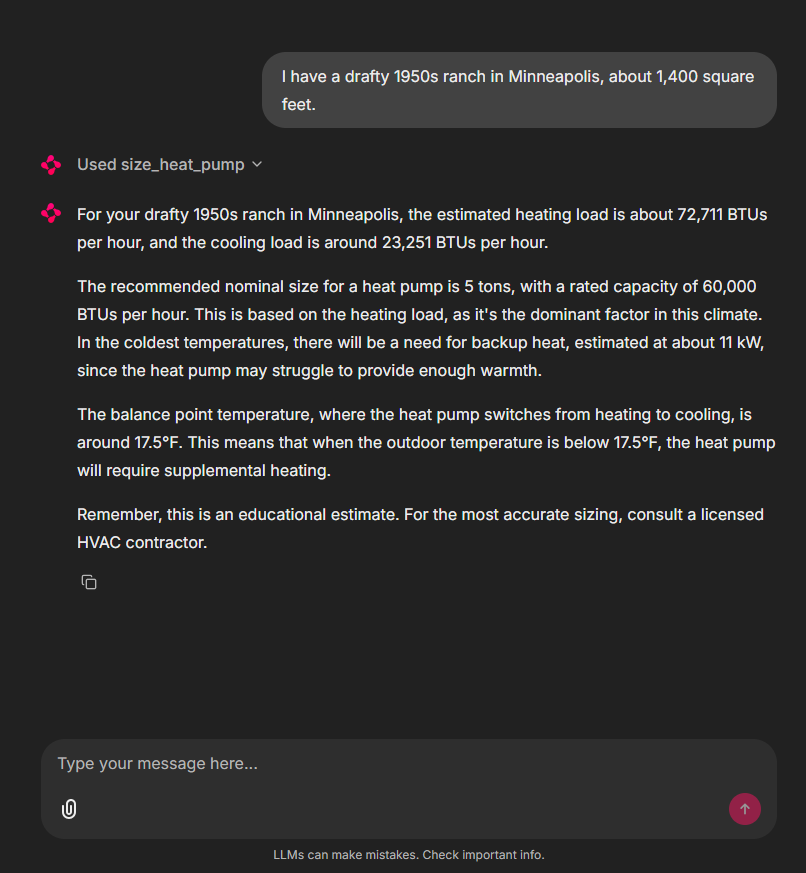
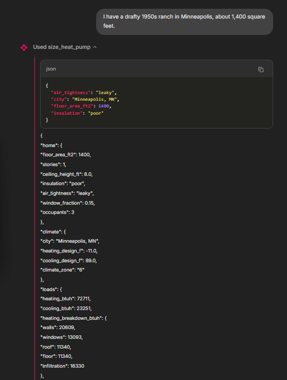

# SizeRight: Heat Pump Sizing Agent

> A **tool-calling LLM agent** that sizes a heat pump from a plain-English description of a home. The model gathers facts and explains results; every number comes from a **deterministic, unit-tested** load calculation, so the answer contains **zero hallucinated figures**.

[-5a4fcf?style=flat-square)](https://ollama.com/library/qwen2.5)
[](https://platform.openai.com/docs/guides/function-calling)
[](https://chainlit.io/)
[](#tests)
[](https://www.python.org/)
[](LICENSE)



---

## Overview

"What size heat pump do I need?" is the first question every buyer asks and the answer usually waits for a site visit. Getting it wrong is expensive either way: an **oversized** unit short-cycles, wastes energy and dehumidifies poorly; an **undersized** one leans on costly electric backup heat on the coldest nights.

SizeRight gives a fast, explainable first estimate. A user describes the home in their own words ("a drafty 1950s ranch, about 1,400 square feet, in Minneapolis") and the agent:

| Step | Who does it |
| :--- | :--- |
| Turns the description into structured inputs (insulation, air tightness, area, city) | **LLM** |
| Asks follow-up questions when something required is missing | **LLM** |
| Looks up design temperatures, computes heating and cooling loads, picks a size | **Python engine** (`sizing.py`) |
| Explains the result: tons, backup heat, balance point, caveats | **LLM**, from the tool's JSON |


---

## Key Features

- **Natural-language intake:** infers technical inputs from everyday descriptions ("drafty" → leaky, "1950s" → poor insulation) and states its assumptions
- **Function calling:** OpenAI-compatible tool schemas (`size_heat_pump`, `list_cities`) with a bounded multi-round tool loop
- **Deterministic engine:** envelope + infiltration heat-loss model, cooling with solar, internal and latent gains and a cold-climate capacity curve
- **Full sizing output:** heating and cooling loads, nominal tons, capacity at design temperature, backup heat (kW), balance point and component breakdown
- **Transparent UI:** each tool call is shown in Chainlit as an expandable step with its arguments and raw result
- **Local or hosted model:** runs fully offline on Ollama (Qwen 2.5 7B) or against GitHub Models
- **Error-tolerant:** fuzzy city matching with suggestions; invalid inputs return as tool errors the model can recover from

---

## System Architecture

```
User message ("1,400 ft² drafty ranch in Minneapolis")
        │
        ▼
LLM (Qwen 2.5 7B via Ollama, or GitHub Models)
        │   extracts facts, asks for anything missing
        ▼
Tool call: size_heat_pump(floor_area_ft2, insulation, air_tightness, city, ...)
        │
        ▼
sizing.py                    ← deterministic, unit-tested
  1. design_conditions()     city → winter/summer design temperatures
  2. calculate_loads()       U·A·ΔT + infiltration + gains, with breakdown
  3. recommend()             size ladder, backup heat, balance point
        │
        ▼
JSON result ──► LLM explains it ──► Chainlit UI (tool call shown as a step)
```



---

## Methodology

### 1. Design Conditions

`data/design_temps.csv` holds approximate winter (heating) and summer (cooling) design temperatures and climate zones for **21 US cities**. Lookup accepts "Minneapolis, MN" or just "Minneapolis", and suggests close matches for typos. Users can also give design temperatures directly.

### 2. Heating Load

Heat loss through the envelope plus air leakage at the winter design temperature, with indoor set to **70 °F**:

```
Q_heat = Σ U·A·ΔT  (walls, windows, roof, floor)  +  1.08 × CFM × ΔT
CFM    = ACH × volume / 60
```

| Input | Levels |
| :--- | :--- |
| **Insulation** (U-values, Btu/h·ft²·°F) | poor · average · good, e.g. walls 0.25 / 0.08 / 0.05, windows 0.90 / 0.50 / 0.30 |
| **Air tightness** (air changes per hour) | leaky 1.0 · average 0.5 · tight 0.25 |
| **Geometry** | square footprint per story; window area = wall area × window fraction (default 15%) |

### 3. Cooling Load

Sensible gains at the summer design temperature (indoor **75 °F**), then a latent factor for humidity:

```
Q_cool = 1.3 × ( conduction + infiltration + 30 Btu/h·ft² × window area + 230 × occupants + 1,200 )
```

### 4. Capacity Curve and Size Selection

Heat pumps lose capacity as it gets colder. Capacity is rated at **47 °F** and falls linearly to **70% at 5 °F** (configurable), extrapolated below 5 °F:

| Decision | Rule |
| :--- | :--- |
| **Sizing basis** | heating-led if heating load > cooling load, otherwise cooling-led |
| **Heating-led** | smallest size on the ladder (1.5–5 tons) whose capacity *at the design temperature* covers the heating load |
| **Cooling-led** | smallest size whose rated capacity covers the cooling load |
| **Backup heat** | (heating load − capacity at design) ÷ 3,412 Btu/h per kW |
| **Balance point** | outdoor temperature where heat pump capacity equals the home's heat loss |

---

## Results

| Home | City (design °F) | Heating load | Cooling load | Recommendation | Balance point |
| :--- | :--- | ---: | ---: | :--- | :---: |
| Drafty 1950s ranch, 1,400 ft² | Minneapolis, MN (−11) | 72,711 Btu/h | 23,251 Btu/h | **5 tons + 11.0 kW backup** | 17.5 °F |
| Tight new build, 2,400 ft², 2 floors | Denver, CO (3) | 23,530 Btu/h | 22,718 Btu/h | **3 tons** | 1.5 °F |
| Average colonial, 2,000 ft², 2 floors | Boston, MA (10) | 31,405 Btu/h | 22,297 Btu/h | **4 tons** | 5.5 °F |
| Average home, 1,800 ft² | Phoenix, AZ (38) | 15,544 Btu/h | 27,377 Btu/h | **2.5 tons** (cooling-led) | 20.5 °F |

**Where the Minneapolis heat goes** (heating load breakdown):

| Component | Btu/h | Share |
| :--- | ---: | :---: |
| Walls | 20,609 | 28% |
| Infiltration (air leaks) | 16,330 | 22% |
| Windows | 13,093 | 18% |
| Roof | 11,340 | 16% |
| Floor | 11,340 | 16% |

The breakdown shows where upgrades pay off: walls and air leakage together are half the heat loss, so wall insulation and air sealing would shrink both the heat pump and the backup heat needed.

---

## Repository Structure

```
size-right/
│
├── sizing.py               # Load calculation, capacity curve, size recommendation
├── agent.py                # System prompt, tool schemas, tool runner, function-calling loop
├── app.py                  # Chainlit chat UI; tool calls rendered as steps
├── chainlit.md             # Welcome screen
├── requirements.txt
├── .env.example            # Ollama or GitHub Models settings
│
├── data/
│   └── design_temps.csv    # Design temperatures for 21 US cities
│
├── tests/
│   ├── test_sizing.py      # Engine tests: physics, invariants, validation
│   └── test_agent.py       # Mocked-LLM tests of the tool-calling loop
│
└── docs/
    ├── demo.png
    └── tool-call.png
```

---

## Setup & Usage

### 1. Clone and install

```bash
git clone https://github.com/AI-Energy-Projects/size-right.git
cd size-right
python -m venv .venv
source .venv/bin/activate         
pip install -r requirements.txt
```

### 2. Choose a model

```bash
cp .env.example .env
```

| Option | Setup | Speed |
| :--- | :--- | :--- |
| **Ollama (local, default)** | install [Ollama](https://ollama.com), then `ollama pull qwen2.5:7b` | ~30 s – 2 min per answer on CPU |
| **GitHub Models (hosted)** | set `LLM_BASE_URL=https://models.github.ai/inference`, `LLM_MODEL=openai/gpt-4.1-mini` and a GitHub token as `LLM_API_KEY` in `.env` | a few seconds |

### 3. Run

```bash
chainlit run app.py -w             # http://localhost:8000
```

Try: *"I have a drafty 1950s ranch, about 1,400 square feet, in Minneapolis. What size heat pump do I need?"*

---

## Tests

```bash
python -m pytest -v                # 11 tests, no model or network needed
```

| Area | What is checked |
| :--- | :--- |
| **Physics direction** | colder climates need more heat; better envelopes need less |
| **Invariants** | the component breakdown sums to the total load |
| **Capacity curve** | rated at 47 °F, exactly the retention value at 5 °F |
| **Recommendation** | chosen size covers the load at design, or backup heat is reported |
| **Climate logic** | hot climates are sized for cooling |
| **Validation** | unknown cities suggest matches; out-of-range inputs are rejected |
| **Agent loop** | a mocked LLM client verifies tool call → tool result → final answer, and that tool errors come back as data |

---

## Dependencies

```
chainlit>=2.0,<3
openai>=1.40
python-dotenv>=1.0
pytest>=8.0
```

---

## Limits

- **Not a Manual J.** An educational first estimate; real sizing needs a room-by-room calculation and a site visit.
- **Approximate climate data.** Use official ASHRAE or ACCA design temperatures for real work.
- **Simplified geometry.** Square footprint, uniform window share, no duct losses or orientation.
- **Small-model wording.** With Qwen 2.5 7B the numbers are always right (they come from code), but explanations occasionally slip. Larger models follow the prompt more closely.

---

## Next Steps

- Capacity-vs-temperature chart with the balance point marked
- Output checks on balance-point and unit wording
- Real equipment specs to recommend specific models
- "Which upgrade cuts the most load?" comparison (air sealing vs insulation vs windows)

---

## Author

Built by **Shriya Padhi** as part of [AI Energy Projects](https://github.com/AI-Energy-Projects), a portfolio of applied AI prototypes for home electrification, energy storage, grid resilience and severe weather.

---

## References

- ACCA [Manual J: Residential Load Calculation](https://www.acca.org/standards/technical-manuals/manual-j) (the full method this simplifies)
- ASHRAE Handbook: Fundamentals, design climatic conditions
- NEEP [Cold Climate Air Source Heat Pump Specification](https://neep.org/heating-electrification/ccashp-specification-product-list) (capacity retention at 5 °F)
- OpenAI [Function calling guide](https://platform.openai.com/docs/guides/function-calling)
- [Ollama](https://ollama.com) · [Qwen 2.5](https://qwenlm.github.io/blog/qwen2.5/) · [Chainlit](https://docs.chainlit.io)
